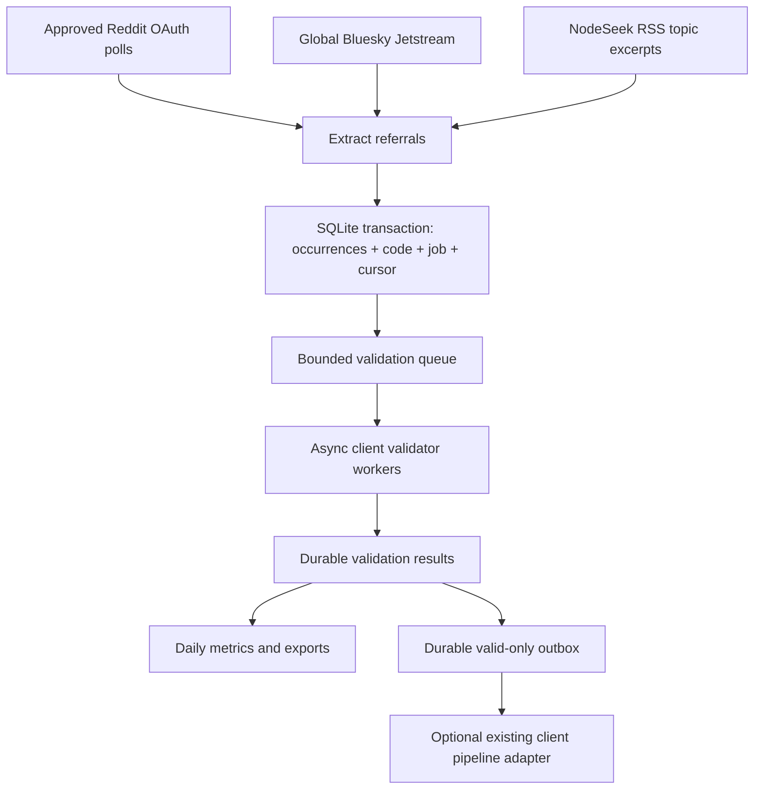

# Collector architecture

Collectors are independent supervised asyncio tasks. They never await validator completion.
The in-memory validation queue is bounded; excess work remains in SQLite jobs. HTTP runs in
a bounded executor; client HTTP uses a separate executor so it cannot consume source slots.
Source payloads have a 4 MB cap; WebSocket buffering is bounded. SQLite commits are short,
synchronous operations on the event loop; this intentionally trades some shared disk
latency for simple atomicity. At high traffic, SQLite/disk throughput must be measured.

Each collector owns its access budget, checkpoint namespace, baseline handling and coverage
diagnostics. Collectors retry failures independently. Unexpected core worker failures stop
the run instead of silently abandoning queued jobs. Pending work survives restart.

Live collection defaults to `VALIDATION_ENABLED=false`. The extraction transaction immediately
saves unknown/not-connected status and the discovery timestamp; validation jobs remain pending
without filling the in-memory queue. Real validation later appends a result and its own time.
Public author identifiers and immutable discovery status are retained by migrations 002/003.

Reddit runs one task per subreddit/listing type plus selected older threads. A shared rate
limiter serializes request admission, not complete requests; comment polls remain independent
of submission response time. Individual listing errors are isolated. Bluesky reconnects through
the supervisor using its durable instance-local sequence cursor; cursor gap advisories fail
closed. Stream counters distinguish normal incoming records from referral matches. New-code
logs occur only after commit, and replayed/duplicate codes do not repeat those logs.

`models.py` defines source events and adapter contracts; `extract.py` contains parsing;
`store.py` owns durable transactions; `collectors.py` contains source adapters;
`pipeline.py` supervises collection/validation/forwarding; `metrics.py` reports measurements;
`cli.py` provides configuration, locking and commands. No existing client implementation was
found to reuse; adapters are explicit integration contracts, not tested client integrations.
